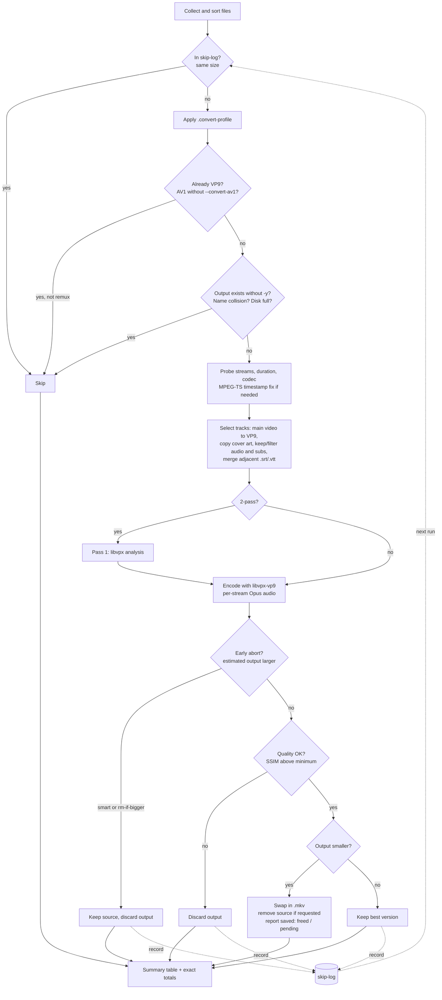

# convert-to-vp9

Batch video converter to **VP9** using FFmpeg and **libvpx-vp9**. Designed to reduce storage for TV recordings, series, and movies with minimal effort.

A conversion of [janroudaut/convert-to-av1](https://github.com/janroudaut/convert-to-av1) (WTFPL): same tool, same options, same workflow — it encodes to VP9 instead of AV1 (SVT-AV1), and shows the space you save much more clearly. See [What changed compared to convert-to-av1](#what-changed-compared-to-convert-to-av1).

## Features

- **In-place conversion** (default) or output to a separate directory
- **Constant-quality VP9** — `-crf N -b:v 0`, row multithreading, alt-ref frames with look-ahead, tile columns sized to the output width, optional **2-pass**
- **10-bit output** (VP9 Profile 2) by default, 8-bit fallback when the libvpx build lacks high bit depth
- **Clear space savings** — per file (source → output, bytes and %, freed now or pending), a live estimate of the final size while encoding, a running total with ETA between files, and an end-of-batch table with exact byte totals
- **MPEG-TS fix** — auto-detects `.ts` containers and applies timestamp correction flags
- **Smart mode** — keeps the best version (source or output) based on file size
- **Early abort** — stops encoding at ~15% if the output is estimated to be larger than the source
- **Subtitle merging** — auto-detects adjacent `.srt`/`.vtt` files (including multi-language) and muxes them into the output MKV; MP4 `mov_text` subtitles are converted to SRT (Matroska cannot store them)
- **Description embedding** — reads adjacent `.txt` files and embeds them as MKV `description` metadata
- **Audio re-encoding** — optional Opus re-encoding with automatic bitrate detection; decided **per stream**, so 5.1/7.1 tracks keep their native channels (no downmix)
- **Language track filtering** — keep only selected audio/subtitle languages (e.g. `fr,en`) to strip unwanted tracks
- **Remux / cleanup mode** — `--copy-streams` strips tracks without re-encoding (fast)
- **Per-directory profiles** — a `.convert-profile` file applies folder-specific flags (e.g. `--movie` for grainy films, `--cartoon` for animation)
- **Cover art safe** — attached cover images are copied, never fed to the encoder
- **HDR safe** — HDR10/HLG colour metadata is detected and carried through to the VP9 stream
- **Output verification** — optional full-decode check (`--verify`) before an output replaces anything
- **Disk-space guard** — a file is skipped up front when the target filesystem can't hold its temp output
- **Resolution scaling** — downscale to 1080p, 720p, or any custom height
- **Recursive mode** — process entire directory trees
- **Sorting** — by size, date, or bitrate
- **File filtering** — skip files below a minimum size or bitrate, exclude by glob pattern or by codec
- **Clean progress bar** — real-time progress with speed, ETA, fps, and the estimated final size
- **Detailed file info** — shows container, duration, bitrate, streams, and detected external files before each conversion
- **Graceful failures** — one failed file doesn't stop the batch; summary table at the end
- **Lock files** — prevents concurrent conversion of the same file
- **Post-batch command** — run a custom command after the batch completes
- **Log stats** — `--stats` turns an accumulated `--log` file into a report (totals, throughput, SSIM)
- **NO_COLOR support** — respects the `NO_COLOR` convention (any non-empty value disables colored output)
- **Dry run mode** — preview what would happen without converting
- **Dependency check** — verify all required tools are installed with `--check`

## Requirements

- `ffmpeg` and `ffprobe` with **`libvpx-vp9`** (VP9 encoder) and **`libopus`** (Opus audio; not needed if every run uses `--copy-audio` or `--copy-streams`)
- For 10-bit output, libvpx must be built with high bit depth (`--enable-vp9-highbitdepth`; true for Debian/Ubuntu packages). Without it the script warns and encodes 8-bit.
- `python3` (for file info display)
- Standard GNU utils: `awk`, `bc`, `numfmt`, `stat`, `mktemp` (plus `df` for the optional disk-space guard)
- CPU time: libvpx-vp9 is slower than SVT-AV1 at comparable settings. Row multithreading and tile columns are always on; more cores help.

Verify your setup:

```bash
./convert-to-vp9.sh --check
```

## Quick start

**The two commands that matter in practice:**

```bash
# THE everyday command — convert a whole library, keep only what's worth it:
# re-encode, verify quality (SSIM), drop the losers, remove sources that
# were beaten, resume where it left off on re-runs
./convert-to-vp9.sh --smart -r --skip-log --log convert.log /path/to/library/

# Then, anytime: what did all those runs actually achieve?
./convert-to-vp9.sh --stats convert.log
```

Everything else is variations:

```bash
# Convert all videos in current directory (in-place, default settings)
./convert-to-vp9.sh .

# Convert a single file
./convert-to-vp9.sh video.mp4

# Smart mode: keep best version, remove source if smaller, abort early if not worth it
./convert-to-vp9.sh --smart .

# Recursively convert an entire series folder
./convert-to-vp9.sh --smart -r /path/to/series/

# Convert to a separate output directory
./convert-to-vp9.sh -o /path/to/output/ *.ts

# Fast encoding for quick results
./convert-to-vp9.sh --fast .

# High quality encoding (slow preset, 2-pass)
./convert-to-vp9.sh --hq .

# Explicit quality and speed
./convert-to-vp9.sh --crf 30 --cpu-used 2 --2pass video.mkv

# Keep only French and English audio + subtitles (drop the rest)
./convert-to-vp9.sh --smart --langs fr,en -r /path/to/series/

# Just clean up an existing file: strip unwanted tracks, no re-encoding
./convert-to-vp9.sh --copy-streams --langs fr,en video.mkv

# Preview what would be done
./convert-to-vp9.sh --dry-run --sort-by-size .
```

## Usage

```
convert-to-vp9 [options] FILES[...]
```

### Output

| Flag | Description |
|------|-------------|
| `-o, --output-dir DIR` | Store converted files in DIR (auto-created) |
| `--in-place` | Convert and replace in-place (default when no `-o`) |

Output files take the source's timestamps **and permissions**.

### File management

| Flag | Description |
|------|-------------|
| `--smart, --keep-best-version` | Combines `--rm-src` + `--rm-if-bigger` + `--quality-check`; keeps the best version |
| `--rm-source, --rm-src` | Remove source if output is smaller |
| `--rm-if-bigger` | Remove output if it's larger than source |
| `-y, --overwrite` | Overwrite an existing output file (default: skip it, so re-running a batch resumes where it left off) |

Two safety guards run before each conversion: an **existing output** is skipped unless `-y` is given (in-place `.mkv` → `.mkv` replacement is always allowed — the target *is* the source), and two sources mapping to the **same output name** (`foo.mp4` + `foo.avi`, or same-named files from different subdirs with `-o`) are detected — the first one wins, the rest are skipped with a warning.

### Quality

| Flag | Description |
|------|-------------|
| `--max-res, --max-h HEIGHT` | Scale down to HEIGHT px if source is taller |
| `--1080, --1080p` | Alias for `--max-res 1080` |
| `--720, --720p` | Alias for `--max-res 720` |
| `--sd, --fast` | Fast encoding (cpu-used 5, CRF 36) |
| `--hq` | High quality (cpu-used 1, CRF 32, 2-pass, `tune-content film`) |
| `--cartoon` | Optimised for animation (no grain handling, higher CRF) |
| `--tv` | Optimised for TV/broadcasts (higher CRF, cpu-used ≥ 5, single pass) |
| `--movie` | Optimised for cinema (grain retention via `tune-content film`, lower CRF) |
| `--crf N` | Set the VP9 CRF directly (0–63, lower = better quality; always with `-b:v 0`) |
| `--preset N`, `--cpu-used N` | Set libvpx-vp9 `-cpu-used` directly (0–8, lower = slower/better) |
| `--2pass, --two-pass` | Two-pass encode: analysis pass, then the final pass (implied by `--hq`) |
| `--1pass, --one-pass` | Force a single pass (e.g. `--hq --1pass`) |
| `--quality-check` | Sampled SSIM comparison after each encode; the output is rejected below the threshold (part of `--smart`) |
| `--min-ssim VALUE` | SSIM rejection threshold, 0–1 (default: 0.92) |
| `--ssim-samples N` | Evenly-spaced sample points for the check (default: 5) |
| `--verify` | Fully decode each output before accepting it (catches corrupt bitstreams; costs one extra decode). Outputs under 128K are always verified |

**Reading SSIM scores — the scale is content-dependent.** SSIM saturates on flat, clean content: 2D animation routinely scores 0.99+ for a good encode, but even a visibly trashed one still lands around 0.985 — while grainy live-action film sits at 0.93–0.96 for the *same* perceived quality. Don't compare scores across content types, and don't read 0.99 as "extra headroom": the default 0.92 threshold is deliberately a catastrophe tripwire (corrupt stream, broken colorspace), not a fine-quality gate. For fine quality, trust the size-based guards and your eyes.

The SSIM check compares the **same frames**: both timelines are rebased to their first frame (an MP4 with AAC audio shifts the MKV video by ~23 ms, which convert-to-av1 compared one frame off), and on MPEG-TS sources, which have no seek index, each sample starts on a source keyframe.

**HDR is preserved:** HDR10 (`smpte2084`/PQ) and HLG sources are detected from the probe and their colour metadata (transfer, primaries, matrix) is carried through to the VP9 stream and the MKV colour elements — an untagged HDR encode would play back washed-out. SDR sources with invalid or missing colour metadata are tagged BT.709.

Speed presets (`--fast`, default, `--hq`) and content presets (`--cartoon`, `--tv`, `--movie`) are combinable in any order: `--fast --cartoon`, `--hq --movie`, etc. An explicit `--crf`/`--preset`/`--2pass`/`--1pass` always wins over whatever the presets would derive (e.g. `--movie --crf 40` encodes at CRF 40, not 30), and all are usable in `.convert-profile` files for per-folder fine-tuning. As in convert-to-av1, a later `--fast`/`--hq` on the same command line resets them (last one wins).

Default: cpu-used 3, CRF 32, 10-bit, single pass.

#### Preset matrix

| | `--fast` | default | `--hq` |
|---|---|---|---|
| *(none)* | cpu5 crf36 | cpu3 crf32 | cpu1 crf32 2-pass film |
| `--cartoon` | cpu5 crf38 | cpu3 crf34 | cpu1 crf34 2-pass |
| `--tv` | cpu5 crf37 | cpu5 crf33 | cpu5 crf33 |
| `--movie` | cpu5 crf34 film | cpu3 crf30 film | cpu1 crf30 2-pass film |

`cpuN` = `-cpu-used N`, `film` = `-tune-content film`. All presets add `-deadline good -b:v 0 -row-mt 1 -auto-alt-ref 1 -lag-in-frames 25 -g 240`, 10-bit `yuv420p10le` and `-tile-columns` from the output width (0 below 512 px, 1 up to 1023 px, 2 for 720p/1080p, 3 for 4K).

#### How the AV1 parameters were mapped to VP9

| convert-to-av1 (SVT-AV1) | convert-to-vp9 (libvpx-vp9) | Why |
|---|---|---|
| `-crf 28` default, scale 0–63 | `-crf 32 -b:v 0` default, scale 0–63 | Same range, different scale. 32 sits in Google's recommended VP9 VOD range (≈31 for 1080p, 32 for 720p). `-b:v 0` makes it pure constant quality |
| preset offsets: fast +4, cartoon +2, tv +1, movie −2 | identical offsets on the VP9 CRF | Keeps the relative behaviour of every preset combination |
| `-preset` 10 / 8 / 4 (fast / default / hq) | `-cpu-used` 5 / 3 / 1 | libvpx speed range is 0–8 (good deadline); the three steps keep the fast/default/slow spacing |
| `--tv` raises the preset to ≥ 10 | `--tv` raises cpu-used to ≥ 5 and drops `--hq`'s 2-pass | Same intent: broadcasts are throughput material |
| `--preset N` 0–13 | `--preset N` / `--cpu-used N` 0–8 | Values 9–13 have no VP9 equivalent and are rejected with a clear error |
| `film-grain=8/10` (`--hq`, `--movie`) | **no VP9 equivalent** → `-tune-content film` + warning | VP9 has no grain synthesis. `tune-content film` is libvpx's grain-retention mode: grain is encoded, not re-synthesised (costs bits) |
| `film-grain-denoise=1` (`--movie`) | **not applied** + warning | Denoising only makes sense when grain is re-synthesised; in VP9 it would strip the grain for good |
| `enable-overlays=1`, `scd=1` | `-auto-alt-ref 1 -lag-in-frames 25` | VP9's alternate reference frames are the counterpart of overlay/temporal-filtered frames; scene cuts are handled by the look-ahead |
| `tune=0` (visual quality) | `-tune-content default` | libvpx's default tuning |
| — | `-tile-columns`, `-row-mt 1` | Required for usable multithreading in libvpx-vp9 |
| — | `-g 240` | libvpx's default key-frame distance (~9999) makes seeking slow; 240 ≈ 10 s at 24 fps |
| — | `--2pass` | libvpx can place alt-ref frames and distribute bits using first-pass statistics; SVT-AV1 was used single-pass. Opt-in (or via `--hq`) because it roughly adds an analysis pass to the encode time |

**Nothing is dropped silently:** whenever a preset requests film grain or denoise, the banner shows it (`(grain=10+denoise requested: no VP9 synthesis)`) and a warning is printed once per batch:

```
WARN: VP9 has no film-grain synthesis: preset request (film-grain=10 + film-grain-denoise) mapped to -tune-content film; denoise not applied (it would strip the grain without re-synthesis)
```

#### 2-pass

With `--2pass` (or `--hq`), libvpx first analyses the video (`pass 1/2`, no output file), then encodes it (`pass 2/2`). Early abort is evaluated during the final pass. The pass statistics live under `$TMPDIR` with the per-run `convert-<pid>-` prefix and are removed on every exit, including Ctrl-C.

### Batch

| Flag | Description |
|------|-------------|
| `-r, --recursive` | Recurse into subdirectories |
| `--sort-by-size [asc\|desc]` | Sort files by size before processing (default: desc) |
| `--sort-by-date [asc\|desc]` | Sort files by mtime before processing (default: desc = newest first) |
| `--sort-by-bitrate [asc\|desc]` | Sort files by overall bitrate (default: desc). Costs one ffprobe per file. The three sort keys are mutually exclusive, last one wins |
| `--min-size SIZE` | Skip inputs smaller than SIZE (default: `128K`; `0` disables). Purely an input filter — output sanity (corrupt-output detection, forced verify) uses a fixed internal 128K threshold |
| `--min-bitrate RATE` | Skip inputs thinner than RATE, **decimal** units (`1500k` = 1 500 000 bit/s; `0` disables, default). Costs one ffprobe per file. A file whose duration cannot be read is kept, not dropped |
| `--exclude PATTERN`, `--ignore PATTERN` | Exclude files matching glob pattern, case-insensitive (repeatable); `codec:NAME` excludes by video codec (`codec:x265` = hevc, `codec:x264` = h264, `codec:vp9`, `codec:av1`) |
| `--skip-log[=FILE]` | Record files not worth converting and skip them on re-runs |
| `--convert-av1` | Also re-encode AV1 sources (skipped by default — see below) |
| `--dry-run` | Preview without converting — shows the same per-file stream table (incl. per-track decisions) as a real run |
| `--no-early-abort` | Disable early abort when output is estimated larger |
| `--early-abort-threshold PCT` | Progress % at which to evaluate (default: 15) |
| `--after CMD` | Run CMD after the batch completes |

**Skipped codecs:** sources that are already **VP9** are skipped. **AV1** sources are skipped too by default: AV1 is the more efficient codec, so re-encoding it to VP9 nearly always grows the file and costs a generation — pass `--convert-av1` if you need VP9 anyway (e.g. for a player without AV1 support). `--copy-streams` bypasses both skips, so VP9/AV1 files can still be cleaned up.

**Skip log (`--skip-log`):** when re-converting a directory, files that came out *not worth it* — SSIM below the target, or VP9 larger than the source — are recorded and **skipped on the next run**. The log defaults to `.convert-skip.list` at the input root (override with `--skip-log=FILE`); paths are stored relative to it (portable if the tree moves) and a recorded source size means a **changed file is retried**. Each entry keeps the size, source mtime, and reason.

```bash
# First pass logs the duds; later passes skip them instantly
./convert-to-vp9.sh --smart -r --skip-log /mnt/x/Series/
```

> **Slow storage (WSL `/mnt`, NAS):** the SSIM quality check does random seeks across multi-GB files, which these mounts handle poorly. For very large files, work from a fast local disk.

**Interrupting:** Ctrl-C stops the whole batch: the running encode is killed, its temp output, lock and 2-pass statistics are removed, the source is untouched, and the summary of what was done so far is printed. (convert-to-av1 only failed the current file and went on with the next one — ffmpeg traps SIGINT and exits normally, so bash never saw the interrupt.) Press `>` to skip just the current file.

### Audio

| Flag | Description |
|------|-------------|
| `--copy-audio` | Keep original audio (no re-encoding) |
| `--opus` | Re-encode audio to Opus (conservative bitrates) |
| `--auto-audio` | Re-encode to Opus only if source bitrate exceeds threshold (default) |
| `--audio-threshold KB/S` | Bitrate threshold for `--auto-audio` (default: 200) |

The audio codec is chosen **per stream**: no global channel remapping is applied, so multichannel tracks (5.1/7.1) keep their native channel count — Opus re-encoding never downmixes surround to stereo. Non-standard channel layouts (e.g. `5.1(side)`) are normalised so `libopus` accepts them. Opus bitrates: mono 64k, stereo 128k, 5.1 256k, 7.1 320k, other 192k.

- **Already-Opus tracks are never re-encoded** (a lossy → lossy generation would only lose quality), whatever the mode.
- **Hidden bitrates are measured, not guessed.** MKV often exposes no per-stream audio bitrate; in auto mode the script samples ~20 s of real packets (one extra `ffprobe` per file for all audio streams) — shown as `~256k` in the file header.

Note: `--hq` also switches the default audio mode from auto to copy.

### Tracks (language filtering)

By default **all tracks are kept**. Filtering is opt-in and identifies tracks by their language tag (2- or 3-letter codes: `fr` matches `fre`/`fra`, `en` matches `eng`).

| Flag | Description |
|------|-------------|
| `--langs LIST` | Keep only these languages for **both** audio and subtitles (e.g. `fr,en`) |
| `--audio-tracks LIST` | Keep exactly these audio tracks — `a:0,a:2` (audio-relative) or `1,3` (absolute stream index). No heuristic: **which tracks are redundant is the caller's call**. An unmatched selector keeps every track rather than none |
| `--audio-langs LIST` | Keep only these audio languages |
| `--sub-langs LIST` | Keep only these subtitle languages |
| `--copy-streams, --remux` | Don't re-encode: just remux and keep selected tracks (fast cleanup) |

- **Untagged / `und` tracks are always kept** (safety against dropping audio).
- If no audio track matches, **all audio is kept** and a warning is printed (a file is never left without sound).
- All tracks in a matching language are kept (default, forced, commentary, etc.).
- Video (including cover art), attachments/fonts, chapters, and metadata are always preserved.

`--copy-streams` performs a pure remux (`-c copy`) — no video or audio re-encoding — ideal for stripping unwanted tracks in seconds. It also works on files that are already VP9 or AV1. The only stream it converts is an MP4 `mov_text` subtitle, which Matroska cannot store (→ SRT, text and language kept).

```bash
# Strip everything except French/English audio and subtitles, re-encode video to VP9
./convert-to-vp9.sh --langs fr,en video.mkv

# Fine-grained: keep only French audio, but French + English subtitles
./convert-to-vp9.sh --audio-langs fr --sub-langs fr,en video.mkv

# Clean an existing file without re-encoding (fast)
./convert-to-vp9.sh --copy-streams --langs fr,en video.mkv
```

### Per-directory profiles

Drop a `.convert-profile` file into a directory (or any parent) and its flags are applied to every video under it.

| Flag | Description |
|------|-------------|
| `--no-profile` | Ignore all `.convert-profile` files |

- Resolved **per file**: the tool walks up from each file's directory and uses the first `.convert-profile` it finds.
- One flag per line or space-separated; `#` starts a comment. Both `--opt value` and `--opt=value` work, and a pair of surrounding quotes around a value is stripped.
- The startup banner shows the **input root's** profile (path + flags) and the effective values it produces.
- Supported flags: presets (`--fast`/`--sd`, `--hq`, `--cartoon`, `--tv`, `--movie`), encoding (`--crf`, `--preset`/`--cpu-used`, `--2pass`, `--1pass`), `--convert-av1`, resolution (`--max-res`, `--1080`, `--720`), audio (`--copy-audio`, `--opus`, `--auto-audio`, `--audio-threshold`), track selection (`--langs`, `--audio-langs`, `--sub-langs`, `--audio-tracks`), quality (`--quality-check`, `--min-ssim`, `--ssim-samples`, `--verify`), early abort (`--no-early-abort`, `--early-abort-threshold`), `--no-merge-subs`, `--copy-streams`/`--remux`, and logging (`--log FILE`, `--skip-log[=FILE]`).
- Relative `--log`/`--skip-log` paths anchor to the profile's directory; a bare `--skip-log` uses `.convert-skip.list` next to the profile.
- `--exclude` (appends to the CLI patterns), `--min-size` and `--min-bitrate` apply per file; `--sort-by-size`/`--sort-by-date`/`--sort-by-bitrate` are honored from the **first input root's** profile only.
- Everything else is ignored with a warning — a bad profile never kills a batch. Deliberately CLI-only: `--smart`, `--rm-if-bigger`, `--rm-source`, `-y` (a dotfile must never delete files) and output/session flags (`-o`, `--in-place`, `--after`, `-r`, …).
- Precedence: a flag explicitly typed on the command line always wins over the profile — including when the profile sets a speed preset: `--crf 30` on the CLI survives a profile's `--hq` (convert-to-av1 lost it there). `--exclude` is the exception: CLI and profile patterns combine.

```bash
# /mnt/videos/Movies/Die Hard (1988)/.convert-profile
--movie

# /mnt/videos/Series/South Park/.convert-profile   (applies to all seasons below)
--cartoon

# Then just run the batch — each folder gets its own profile automatically:
./convert-to-vp9.sh --smart -r /mnt/videos/
```

### Subtitles

| Flag | Description |
|------|-------------|
| `--no-merge-subs` | Don't merge adjacent `.srt`/`.vtt` files into output |

When merging is enabled (default), the script finds all `.srt` and `.vtt` files matching the video filename (e.g., `video.srt`, `video.fr.srt`, `video.en.vtt`) and muxes them as subtitle tracks. Merged subtitle files are deleted when `--rm-source` is active. Embedded subtitles are copied; MP4 `mov_text` subtitles become SRT (shown as `↻ srt` in the stream table).

Adjacent `.txt` files are embedded as MKV `description` metadata but are **never deleted**.

### Space savings

The space you gain is shown at four points, always on exact byte counts:

1. **Live, while encoding** — the progress line extrapolates the bytes written so far to the full duration: `est. 1.4M saved=67%` (red `larger=+N%` when the output is heading above the source). Early estimates are rough (look-ahead and headers distort the first seconds) and firm up as the encode progresses.
2. **Per file, when it is done** — a highlighted line with source → output, the delta in bytes and %, and the exact byte counts, followed by where the space went:
   - `freed now` — the source was removed (`--rm-src`, `--smart`) or replaced in place (`.mkv` → `.mkv`);
   - `pending` — the source is still on disk: the space frees once you delete it.
   A larger output is shown as `▲ LARGER +N (+x%)`, never as a saving.
3. **Between files** — `batch: 2/3 done | saved 664K (72.5% of 917K) | freed 664K, pending 0B | ~00:12:30 left`.
4. **At the end** — the table (Saved, %, Space columns) and the totals: `exact … bytes`, `freed now`, `pending`. `freed + pending = saved`, and the totals are sums of the real `stat` sizes (checked byte for byte by the test suite).

### Logging

| Flag | Description |
|------|-------------|
| `-l, --log FILE` | Append a synthetic, greppable per-file TSV log to FILE (time, status, sizes, saved %, wall time, note) |
| `--stats FILE` | Summarise a `--log` file and exit: per-status counts, converted totals, encode time/throughput, SSIM min/avg |
| `--stats-live FILE` | Same report in follow mode: redraws whenever the log grows (`Ctrl-C` to quit) |
| `-v, --verbose` | Verbose output (incl. the full ffmpeg command lines) |
| `--no-progress` | Disable progress bar |

The `--log` keeps the convert-to-av1 format (human-readable sizes), so `--stats` totals are approximations from rounded values; the exact byte totals are in the end-of-batch summary.

### Other

| Flag | Description |
|------|-------------|
| `--check` | Check dependencies (incl. libvpx-vp9 10-bit support and libopus) and exit |
| `-h, --help` | Show this help |
| `--version` | Show version |

## How it works



1. **Probe** — reads container format, streams, duration, and codec info
2. **Skip** — skip files already in VP9 (and AV1 unless `--convert-av1`), unless `--copy-streams`; skip files recorded in the skip-log (`--skip-log`)
3. **MPEG-TS fix** — if the container is MPEG-TS, applies `-fflags +genpts+igndts -avoid_negative_ts make_zero`
4. **Merge** — detects and includes adjacent subtitle/description files
5. **Select tracks** — keeps all streams by default, or filters audio/subtitles by language; only the first video stream is encoded to VP9 while cover-art streams are copied verbatim
6. **Encode** — runs FFmpeg with libvpx-vp9 (optionally an analysis pass first), piping progress to a real-time monitor with a live size estimate
7. **Early abort** — at the configured threshold (default 15%), estimates final output size; aborts if it would be larger than input (only when `--smart` or `--rm-if-bigger`)
8. **Post-process** — SSIM / size / decode checks on the temp file, then smart-mode logic, source removal, in-place swap; reports the saving (freed now / pending)
9. **Summary** — table of all results with sizes and savings, plus exact byte totals

## Example output

A real run (`--smart --langs fr,en --sort-by-size asc .` on three files; the progress bar lines are omitted). Each stream shows what happens to it: `↻ vp9`/`↻ opus`/`↻ srt` re-encode or convert, `✓ copy` kept as-is, `✗ skip` dropped. A `~` before an audio bitrate means it was measured from real packets.

```
── convert-to-vp9 v1.0.0 ───────────────────────
  output ........... in-place
  encoder .......... libvpx-vp9 cpu-used=3 crf=32 10-bit 1-pass tune=default
  skip ............. VP9 and AV1 sources (--convert-av1 to re-encode AV1)
  audio ............ Opus if > 200 kb/s
  keep langs ....... audio: fr,en | subs: fr,en
  flags ............ smart, rm-source, rm-if-bigger
  early abort ...... 15%
  quality check .... SSIM >= 0.92 (5 samples)
  subtitles ........ merge .srt/.vtt
  profiles ......... .convert-profile (per dir)
  sort ............. size asc
────────────────────────────────────────────────
  Already VP9, skipping: ./already_vp9.mkv
batch: 1/3 done
▸ [2/3] S01E05 - Pilot.mkv   917K
  video     ↻ vp9    h264       640×360      3710k     2s @ 25fps (matroska)
  audio     ✓ copy   aac        stereo       ~96k      [eng]
  audio     ✓ copy   aac        5.1          ~188k     [fre]
  audio     ✗ skip   aac        stereo                 [spa]
  subtitle  ✓ copy   subrip                            [eng]
  subtitle  ✓ copy   subrip                            [fre]
  → ./S01E05 - Pilot.mkv
  Conversion done in 00:00:01 (avg 50.0 fps, 2.0x).
  Quality check (SSIM sampling)...
  SSIM: 0.996354 (min: 0.92)
  ▼ SAVED 664K (72.5%)  917K -> 253K  [938419 -> 258492 bytes, -679927]
    space: 664K freed now (source removed or replaced)
batch: 2/3 done | saved 664K (72.5% of 917K) | freed 664K, pending 0B
▸ [3/3] S01E06 - Finale.mp4   4.1M
  video     ↻ vp9    h264       1920×1080    16959k    2s @ 25fps (mov)
  audio     ✓ copy   aac        mono         69k       [und]
  → ./S01E06 - Finale.mkv
  Conversion done in 00:00:10 (avg 5.0 fps, 0.2x).
  Quality check (SSIM sampling)...
  SSIM: 0.996498 (min: 0.92)
  ▼ SAVED 2.7M (64.7%)  4.1M -> 1.5M  [4239960 -> 1494843 bytes, -2745117]
    space: 2.7M freed now (source removed or replaced)
```

While a file encodes, the progress line carries the live estimate:

```
  [ 45%] [#############-----------------] 00:25:24/00:56:28 | fps: 42.1 1.9x | ETA: 00:16:20 | 2870kb/s | est. 2.8G saved=61%
```

With `--2pass`/`--hq` the line is prefixed with `pass 1/2` (analysis, no estimate — nothing is written yet) and `pass 2/2`.

End-of-batch summary of the same run:

```
File                                               Status          Input     Output      Saved       % Space    Note
-------------------------------------------------- ---------- ---------- ---------- ---------- ------- -------  ----
already_vp9.mkv                                    SKIPPED          174K        ---        ---     ---          already VP9
S01E05 - Pilot.mkv                                 OK               917K       253K       664K   72.5% freed    saved 72.5% (664K) ssim=0.996354
S01E06 - Finale.mp4                                OK               4.1M       1.5M       2.7M   64.7% freed    saved 64.7% (2.7M) ssim=0.996498
Total: 5.0M -> 1.7M | saved 3.3M (66.1%) over 2 converted file(s)
  exact ........... 5178379 -> 1753335 bytes = 3425044 bytes saved
  freed now ....... 3.3M (3425044 bytes, 2 file(s): source removed or replaced)
  pending ......... 0B (0 bytes, no source left to delete)
OK: 2 | Skip: 1 | Abort: 0 | Fail: 0 | Total: 3 | elapsed: 00:00:14
```

With `--log FILE`, each file also gets one synthetic, tab-separated line, and each session opens with a commented header (format example):

```
# ── session 2026-10-24T13:05:01+02:00 — convert-to-vp9 v1.0.0
# output: in-place | encoder: libvpx-vp9 cpu-used=3 crf=32 10-bit 1-pass tune=default | audio: auto > 200 kb/s
# flags: smart, rm-source, rm-if-bigger, quality-check>=0.92 | early-abort: 15% | profiles: per-dir
# files: 3 queued (5.1M)
```

`--stats` turns that accumulated log into a report (per-status counts, converted totals, encode time/throughput, SSIM min/avg); `--stats-live` (alias `--live-stats`) redraws it whenever the log grows.

## Supported formats

Input: `mp4`, `mkv`, `avi`, `mov`, `wmv`, `flv`, `ts`, `m2ts`, `mts`, `m4v`, `webm`, `mpg`, `mpeg`

Output: MKV (Matroska) — chosen for its broad codec and subtitle support.

Cover images are copied as an additional still-image video stream; ffmpeg's Matroska muxer does not keep the `attached_pic` flag (behaviour unchanged from convert-to-av1).

## What changed compared to convert-to-av1

**Encoder:** SVT-AV1 → libvpx-vp9, with the preset mapping, 2-pass and the film-grain handling described [above](#how-the-av1-parameters-were-mapped-to-vp9). New options: `--cpu-used` (alias of `--preset`), `--2pass`/`--two-pass`, `--1pass`/`--one-pass`, `--convert-av1`. All convert-to-av1 options are still accepted; `--preset` now takes 0–8.

**Space savings display:** per-file result line with bytes and %, freed/pending accounting, live size estimate, running batch total, exact byte totals in the summary.

**Fixes of inherited bugs** (each covered by a test):

- `--check` could exit with 141: `bc --version | head -1` under `pipefail` + `errexit` dies of SIGPIPE when `head` closes the pipe early.
- MP4 files with `mov_text` subtitles failed (Matroska cannot store them; with SVT-AV1 the encoder then hung instead of failing). They are converted to SRT.
- The SSIM quality check compared frames one frame apart on MP4/AAC sources (≈0.92 for a ≈0.996 encode — enough for `--smart` to reject good encodes) and decoded garbage on MPEG-TS samples (no seek index). Both timelines are now aligned, and TS samples start on keyframes.
- Ctrl-C failed the current file and carried on with the next one; it now stops the batch and cleans up.
- A `.convert-profile` with `--hq`/`--fast` overwrote an explicit CLI `--crf`/`--preset`.
- Outputs were created with mode `0600` (from `mktemp`); they now take the source's permissions.
- The banner's title rule cut a multi-byte character in half under a non-UTF-8 locale.

## Testing

```bash
bash -n convert-to-vp9.sh test.sh option-matrix.sh     # syntax
shellcheck convert-to-vp9.sh test.sh option-matrix.sh  # lint
bash test.sh            # integration suite (94 tests, synthetic files)
bash option-matrix.sh   # every CLI option once, checked with ffprobe -> TESTMATRIX.md
```

`option-matrix.sh GROUP…` runs single groups (`output files quality video batch audio tracks logging`); `option-matrix.sh report` rewrites `TESTMATRIX.md` from the accumulated results.

## Acknowledgements

To **janroudaut** for convert-to-av1, which this is a conversion of. To the **FFmpeg** developers, the **libvpx/WebM** project, and the **assembly masters** whose hand-written SIMD makes real-time video possible. This tool is just a shell script standing on those giants' shoulders.

## License

[WTFPL](http://www.wtfpl.net/) — Do What The Fuck You Want To Public License. See `LICENSE` (unchanged from the original).

Based on [convert-to-av1](https://github.com/janroudaut/convert-to-av1) by janroudaut, released under the WTFPL, which explicitly allows modified copies as long as the name is changed — hence `convert-to-vp9`.
